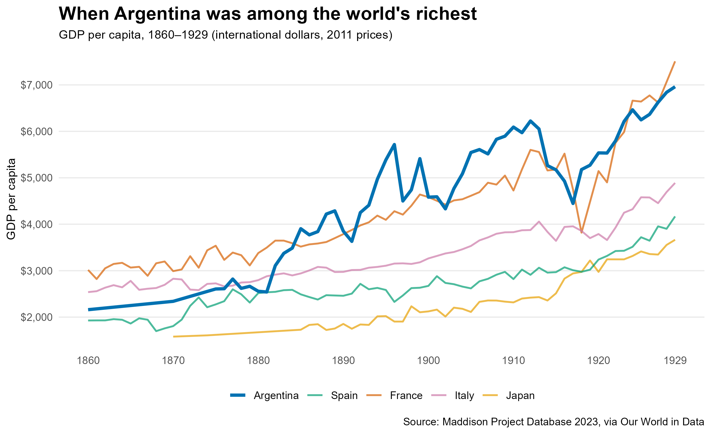
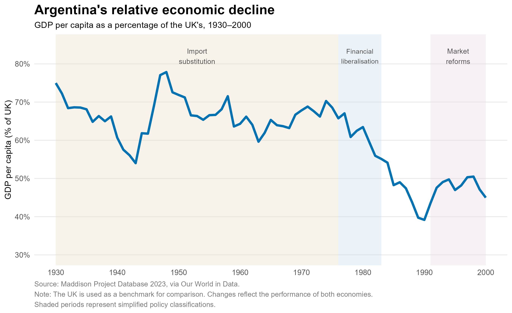
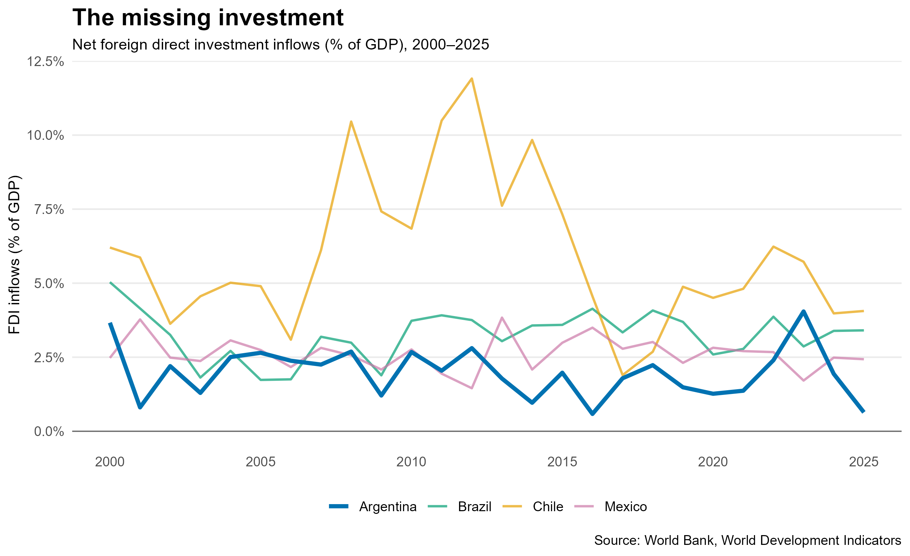
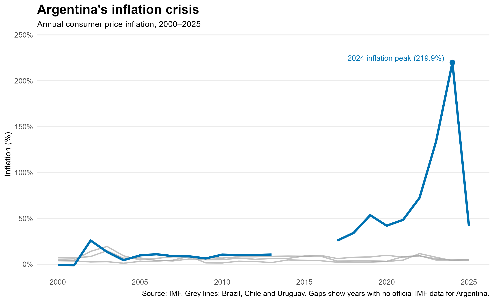

# The Fourth Kind of Country: Argentina's Economic Paradox

At the start of the twentieth century, Argentina was one of the richest countries in the world. A century later, it had become a byword for economic crisis. This project uses historical and modern economic data to trace that decline and asks why Argentines still keep "dollars under the mattress".

📄 **[Read the full article](article.md)**

All analysis and graphs were made in **R** (tidyverse and ggplot2).

---

## Key findings

| | Finding | Graph |
|---|---|---|
| 1 | In 1913, Argentina's GDP per capita was higher than that of France, Italy and Japan | [Graph 1](#graph-1-gdp-per-capita-18601929) |
| 2 | Argentina's GDP per capita fell from about 75% of the UK's in 1930 to about 40% by 2000 | [Graph 2](#graph-2-gdp-per-capita-as-a--of-the-uks-19302000) |
| 3 | From 2000 to 2025, net FDI inflows averaged about 2% of GDP in Argentina, compared with 3.2% in Brazil, 2.6% in Mexico and almost 6% in Chile | [Graph 3](#graph-3-foreign-direct-investment-20002025) |
| 4 | Argentina's inflation peaked at 219.9% in 2024, while its neighbours stayed in single digits | [Graph 4](#graph-4-inflation-20002025) |

---

## The graphs

### Graph 1: GDP per capita, 1860–1929
Argentina compared with Spain, France, Italy and Japan during its "golden age".



### Graph 2: GDP per capita as a % of the UK's, 1930–2000
Argentina's long relative decline, with three broad policy periods shaded. The shading is a simplification and does not show that any one policy caused the decline.



### Graph 3: Foreign direct investment, 2000–2025
Net FDI inflows as a share of GDP. Argentina had the lowest inflows of the four countries in 19 of the 26 years.



### Graph 4: Inflation, 2000–2025
Argentina compared with Brazil, Chile and Uruguay (grey). Gaps in Argentina's line are years with no official IMF data, during a period when the reliability of Argentina's statistics was disputed.



---

## Project structure

```
├── README.md          ← this page
├── article.md         ← the full article
├── run_all.R          ← runs all four scripts in order
├── data/              ← raw data files
├── scripts/
│   ├── graph_1_gdp_with_spain.R
│   ├── graph_2_arg_and_uk.R
│   ├── graph_3_fdi.R
│   └── graph_4_inflation.R
└── output/            ← the graphs (PNG)
```

Each script loads its data, cleans it, prints the figures quoted in the article, then draws and saves one graph.

## How to run it

1. Download or clone this repository.
2. Open the `.Rproj` file in RStudio.
3. Install the packages (you only need to do this once):
   ```r
   install.packages(c("tidyverse", "scales", "readxl"))
   ```
4. Open `run_all.R` and click **Source**. The four graphs will be saved to `output/`.

## Data sources

| Data | Source | Used in |
|---|---|---|
| GDP per capita (historical) | [Maddison Project Database 2023](https://www.rug.nl/ggdc/historicaldevelopment/maddison/), via [Our World in Data](https://ourworldindata.org/grapher/gdp-per-capita-maddison-project-database) | Graphs 1 and 2 |
| Foreign direct investment, net inflows (% of GDP) | [World Bank, World Development Indicators](https://data.worldbank.org/indicator/BX.KLT.DINV.WD.GD.ZS) | Graph 3 |
| Inflation, consumer prices (annual %) | [IMF DataMapper](https://www.imf.org/external/datamapper/) | Graph 4 |

The article also draws on a small informal survey of Argentine contacts. To protect respondents' privacy, the raw responses are not included here.

## Author

**Joe Ewbank**
